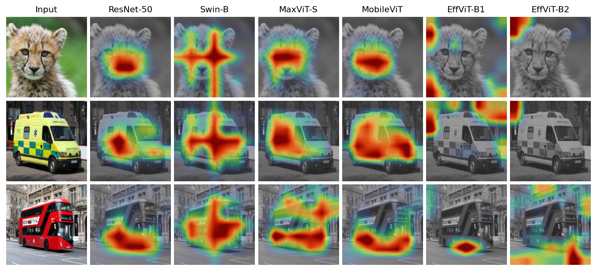

# Does Explainability Transfer?

### A Controlled Benchmark of Attribution Methods on Vision Transformers and CNNs

Sathiyamohan Nishankar · Nethmi Pathirana · Pubudu Sanjeewani · Asanka Perera · Selvarajah Thuseethan

[](https://github.com/Nishan-Charlie/VIT_XAI_Bench/actions/workflows/ci.yml)
[](https://github.com/Nishan-Charlie/VIT_XAI_Bench/actions/workflows/pages.yml)
[](pyproject.toml)
[](LICENSE)

**[Interactive results](https://nishan-charlie.github.io/VIT_XAI_Bench/)** ·
[Reproducibility guide](docs/reproducibility.md) ·
[Scientific integrity record](docs/scientific_integrity.md)

---

## TL;DR

Attribution-method rankings established on CNNs **do not transfer** to
transformer backbones. Of the 11 methods that run on every backbone,
**all 11 take a different rank** on the transformers than on ResNet-50 under
the bounding-box Pointing Game, and **8 of 11** under the dense-mask
Energy-Based Pointing Game (EBPG), the localisation metric of record.

```bash
git clone https://github.com/Nishan-Charlie/VIT_XAI_Bench && cd VIT_XAI_Bench
pip install -e ".[dev]"
python scripts/smoke_test.py     # ~30 s, CPU, no downloads
make reproduce                   # records -> validation -> figures -> website data
```

Every number in the figures and on the website is generated from
`results/processed/records.json`, which `scripts/build_results.py` builds from
the committed benchmark runs. Nothing is hardcoded.

---

## Contents

- [Research question](#research-question)
- [Main findings](#main-findings)
- [Revision of November 2026](#revision-of-november-2026)
- [Benchmark scope](#benchmark-scope)
- [Evaluation protocol](#evaluation-protocol)
- [Installation](#installation)
- [Quick start](#quick-start)
- [Reproducing the benchmark](#reproducing-the-benchmark)
- [Configuration](#configuration)
- [Result format](#result-format)
- [Interactive website](#interactive-website)
- [Hardware and runtime](#hardware-and-runtime)
- [Known gaps](#known-gaps)
- [Scientific integrity](#scientific-integrity)
- [Troubleshooting](#troubleshooting)
- [Citation](#citation)

---

## Research question

> **Are attribution methods that perform well on CNNs equally reliable on modern
> transformer architectures?**

Benchmarks routinely establish a ranking of attribution methods on a
convolutional backbone and then apply the winner elsewhere. That inference holds
only if the ranking is a property of the _method_ rather than of the
_architecture it was measured on_. This benchmark fixes the dataset, the metrics
and the protocol, varies the backbone across five architecture families, and
reads off whether the order survives.

---

## Main findings

| Finding | Where to verify |
| --- | --- |
| Rankings are architecture-dependent: most methods change rank between ResNet-50 and the transformers, under both localisation metrics. | `figures/paper/cnn_to_transformer_transfer.pdf`, `figures/bench/bench_rankflip.pdf` |
| The bounding-box Pointing Game saturates (a random peak already scores about 0.6). Under the dense-mask EBPG no method exceeds 0.60, and VarGrad ties or beats Grad-CAM on 5 of the 8 backbones. | `figures/paper/heatmap_ebpg.pdf`, `results/revision_neucom/analysis/tab_ebpg_all.tex` |
| Grad-CAM localises on the CNN, isotropic, hierarchical and hybrid backbones and fails on the linear-attention EfficientViT: EBPG 0.25 on EfficientViT-B2, below the 0.31 of a random map. | `figures/paper/heatmap_ebpg.pdf`, `figures/bench/bench_qualitative.png` |
| Grad-CAM++ is unstable wherever the class score is not a pooled linear read-out of the feature map. Its closed-form weights have a pole; near it the map collapses to zero (on 71% of the 1,000 images for MaxViT-S) or blows up. The same happens on the convolutional ConvNeXt, so attention is not the cause. | `figures/revision/gcpp_mechanism.pdf`, `results/revision_neucom/analysis/tab_mechanism.tex` |
| Architecture family, not model size, drives the CAM results. Over 21 backbones, the family explains 85% of the variance of Grad-CAM EBPG and 87% of its median Max-Sensitivity (ranked); the parameter count alone explains less than 1% of either. | `figures/revision/capacity.pdf`, `results/revision_neucom/analysis/tab_capacity.tex` |
| Faithfulness Correlation barely separates methods: values cluster near zero across the whole grid. | `figures/paper/heatmap_faithfulness_correlation.pdf` |
| Attribution cost spans almost three orders of magnitude: Occlusion takes about 365× as long as Saliency per explanation. | `figures/paper/computational_cost.pdf` |
| The evaluation dimensions disagree with each other, so a single-metric ranking is not defensible. | `figures/paper/metric_correlation.pdf` |

### The failure is visible without any metric



Grad-CAM on the same three images across six backbones. It localises the object
on the CNN, hierarchical and hybrid models, then breaks down on the
linear-attention **EfficientViT** variants, where the heat lands on background
corners instead of the object. Swin-B shows a separate artefact: the cross shape
is its 7×7 terminal grid upsampled 32×, not a property of the explanation.

The full backbone × method gallery is
[`figures/bench/qualitative_grid_cat.png`](figures/bench/qualitative_grid_cat.png)
and is on the [project page](https://nishan-charlie.github.io/VIT_XAI_Bench/#gallery).

---

## Revision of November 2026

The paper was revised after review (NEUCOM-D-26-16590). The revision changed
how the benchmark is run and scored, so the published result set was produced
again from scratch.

- **The five-metric grid was re-run under fixed seeds.** Every evaluation
  reseeds Python, NumPy and PyTorch from a hash of its seed, backbone, method and
  image, so each cell reproduces on its own, whatever ran before it
  (`configs/revision_grid_seeded*.yaml`, `results/revision_grid_seeded*/`).
  The July result set was not seeded.
- **Every image is scored.** A method can return a constant map, on which every
  metric is undefined. Such an image now gets no credit (0 on PG, EBPG, FC, FE
  and SP) instead of being left out, so a method is never averaged only over the
  images it happens to work on. For Max-Sensitivity it counts as a robustness
  failure (unbounded). Because MS is unbounded and heavy-tailed, its cells are
  medians, and a cell is ∞ when the method fails on at least half of the images
  (`xai_bench/scoring.py`).
- **Grad-CAM on ViT-B/16 reads the right layer.** The head of a class-token ViT
  reads only the class token, so the patch tokens of `forward_features` get no
  gradient and Grad-CAM on them is an all-zero map. The CAM methods target the
  last block's input normalisation instead and now raise an error if their target
  layer gets no gradient.
- **Each checkpoint sees its own input statistics.** ViT-B/16 (mean = std = 0.5)
  and MobileViT-v2 (mean 0, std 1) were trained with non-ImageNet statistics; an
  exact affine map inside the model converts the benchmark's input for them.
- **The dense-mask localisation is in the results.** EBPG is scored on the 1,000
  images for all 13 methods and is part of `records.json`.
- **The gallery was corrected.** Its ViT-B/16 Grad-CAM cells had been blank, and
  it showed AttnLRP on six backbones where only a generic fallback runs; AttnLRP
  is now shown on ViT-B/16 only.

The July 2026 summaries (10 backbones, no seeds, undefined images left out, mean
MS) stay in `results/raw/benchmark_runs.csv` for the record; see
[Result format](#result-format) to rebuild them. ConvNeXt-B and DeiT-B were part
of that set but not of the paper's grid; they appear in the CAM analyses over 21
backbones in `results/revision_neucom/`.

---

## Benchmark scope

### Architectures (8 in the grid)

| Family | Backbones | Attention |
| --- | --- | --- |
| CNN | ResNet-50 | none (convolutional) |
| Isotropic ViT | ViT-B/16 | global self-attention |
| Hierarchical | Swin-B, PVTv2-B2 | shifted-window / spatial-reduction |
| Hybrid / multi-axis | MaxViT-S, MobileViTv2-1.0 | multi-axis / separable |
| Linear attention | EfficientViT-B1, EfficientViT-B2 | cascaded linear attention |

Thirteen further backbones (ResNet-18/101, ConvNeXt-T/B, ViT-S, DeiT-S/B,
Swin-T, PVTv2-B0/B4, MaxViT-T, MobileViTv2-2.0, EfficientViT-B3) enter only the
CAM analyses that separate architecture family from model size.

### Attribution methods (13)

| Family | Methods |
| --- | --- |
| Gradient | Saliency, Input × Gradient, Integrated Gradients, SmoothGrad, VarGrad, GradientSHAP |
| CAM | Grad-CAM, Grad-CAM++ |
| Perturbation | Occlusion, RISE, LIME |
| Attention / LRP | Attention Rollout, AttnLRP (ViT-B/16 only) |

### Dataset

The benchmark evaluates on **ImageNet-S**: ImageNet validation images paired
with pixel-level segmentation masks. The masks give localisation a real object
boundary rather than a bounding box.

| | |
|---|---|
| Source | [`braceletboy/imagenet-s`](https://huggingface.co/datasets/braceletboy/imagenet-s) on the Hugging Face Hub |
| Split used | `validation` |
| Images | a fixed set of 1,000 (161 classes) |
| Original project | [LUSSeg/ImageNet-S](https://github.com/LUSSeg/ImageNet-S) |
| Cached in this repo | no: `data/` is gitignored; you build the caches locally |

Because faithfulness and robustness need tens to hundreds of forward passes per
image, the costlier analyses use a fixed leading subset of the 1,000 images:

| Analysis | Images |
| --- | --- |
| Five-metric grid (FC, FE, PG, MS, SP) | 100 for ResNet-50 and ViT-B/16, 50 for the other six backbones |
| Dense-mask localisation (EBPG) | 1,000; 100 for Integrated Gradients and the three perturbation methods |
| Multi-seed robustness | 100 (30 for VarGrad), 3 seeds × 10 perturbations |

Both dataset entry points stream from the same source:

```python
from datasets import load_dataset

ds = load_dataset("braceletboy/imagenet-s", split="validation", streaming=True)
```

- `imagenets` streams directly (registered in `xai_bench/datasets/imagenet_s.py`)
- `imagenets_cached` reads a local `.pt` cache built by `scripts/cache_imagenets.py`

The configs use `imagenets_cached`. Streaming is flaky over long runs, so the
cache script pulls once with retries and every run then reads from disk, which
also pins the runs to a fixed sample set.

```bash
pip install -e ".[data]"          # brings in `datasets`, needed only for streaming
python scripts/cache_imagenets.py # -> data/ImageNetS/cache_validation_*.pt
```

### Evaluation dimensions

| Dimension | Metric | Cells in `records.json` |
| --- | --- | --- |
| Faithfulness | Faithfulness Correlation, Faithfulness Estimate | 90 per metric |
| Localisation | Pointing Game (bounding box), Energy-Based Pointing Game (mask) | 90 per metric |
| Robustness | Max-Sensitivity (median) | 90 per metric |
| Complexity | Sparseness (Gini) | 90 per metric |
| Computational cost | Attribution time (ms) | per method |

Canonical names live in [`xai_bench/taxonomy.py`](xai_bench/taxonomy.py); adding
a backbone or method means editing that one file.

---

## Evaluation protocol

- **Input.** 224 × 224, ImageNet normalisation; checkpoints trained with other
  statistics receive their own through an affine map inside the model.
- **Target.** The ground-truth ImageNet label, so the explained class and the
  scored mask refer to the same object.
- **CAM target layer.** The terminal feature map of `forward_features` (a 7 × 7
  grid on the hierarchical, multi-axis and linear-attention backbones); for the
  class-token ViT, the input normalisation of the last block.
- **Map normalisation.** Channels are summed; the inherently signed methods (IG,
  Input × Gradient, GradientSHAP, Occlusion, LIME) take the absolute value;
  AttnLRP is passed with its sign; Quantus divides by the maximum absolute value.
- **Seeds.** One seed per evaluation, derived from (seed, backbone, method,
  image) with crc32; the grid uses seed 0.
- **Scoring.** Every image enters every cell; constant maps get no credit and
  are unbounded on MS; MS cells are medians, the others means.
- **Metric budgets.** FC: 20 runs, subset size 224. FE: 448 features per step.
  MS: 3 perturbations, radius 0.2 (10 in the multi-seed analysis).

---

## Installation

```bash
python -m venv .venv && source .venv/bin/activate   # Windows: .venv\Scripts\activate
pip install -e ".[dev]"       # core + test/lint
pip install -e ".[lrp]"       # optional: AttnLRP (needs lxt, zennit)
```

Python 3.10–3.12. `quantus` is a core dependency, not an extra.

---

## Quick start

### Verify the install (no data, no GPU, no downloads)

```bash
python scripts/smoke_test.py
```

Exercises dataset → model → attribution → metrics → records → validation → JSON
on synthetic data with a randomly initialised backbone. Ends with
`25/25 checks passed`.

### Minimal example

```python
import torch
from xai_bench import MODELS, METHODS, METRICS
from xai_bench.utils import set_seed

set_seed(42)

wrapper = MODELS.get("resnet50")()          # timm backbone + benchmark metadata
wrapper.model.eval()

explain = METHODS.get("grad_cam")(model_wrapper=wrapper, model=wrapper.model)
image = torch.randn(1, 3, 224, 224)
attribution = explain(image, target=207)     # [1, 224, 224]

score = METRICS.get("sparseness")(
    attr=attribution[0], metadata={}, model=wrapper.model,
    image=image[0], target=207, metric_kwargs={},
)
print(f"sparseness: {float(score):.4f}")
```

### Run a benchmark sweep

```bash
python -m xai_bench.runner --config configs/revision_grid_seeded.yaml
```

---

## Reproducing the benchmark

Full detail, including data acquisition and expected runtimes, is in
**[docs/reproducibility.md](docs/reproducibility.md)**.

```bash
make reproduce      # build records -> validate -> figures -> website data
```

Stage by stage:

| Stage | Command |
| --- | --- |
| 1. Verify install | `python scripts/smoke_test.py` |
| 2. Prepare data | `python scripts/cache_imagenets.py` (you supply the images) |
| 3. Run the grid | `python -m xai_bench.runner --config configs/revision_grid_seeded.yaml` (and `_attnlrp`, `_50`) |
| 4. Run the localisation and CAM analyses | `scripts/revision_neucom/` (see its README) |
| 5. Consolidate | `python scripts/build_results.py` |
| 6. Validate | `python scripts/validate_results.py` |
| 7. Figures | `python scripts/generate_figures.py` and `python scripts/bench/benchmark_figures.py` |
| 8. Website data | `python scripts/export_web_data.py` |

`make help` lists every target.

> **Methods that must run in isolation.** `attnlrp` patches timm classes; once
> patched, every other gradient-based method in the same process changes. It has
> its own config (`configs/revision_grid_seeded_attnlrp.yaml`); run it in a
> separate process.

---

## Configuration

Experiments are YAML; the CLI overrides any field. The grid of the paper:

```yaml
models: ["resnet50", "vit_base_patch16_224"]
methods: ["saliency", "integrated_gradients", "smoothgrad", "input_x_gradient",
          "vargrad", "gradient_shap", "grad_cam", "grad_cam_plus_plus",
          "attention_rollout", "lime", "occlusion", "rise"]
metrics: ["faithfulness_correlation", "faithfulness_estimate", "pointing_game",
          "max_sensitivity", "sparseness"]

metric_kwargs:
  faithfulness_correlation: { nr_runs: 20, subset_size: 224, return_aggregate: false }
  faithfulness_estimate: { features_in_step: 448, return_aggregate: false }
  max_sensitivity: { nr_samples: 3, lower_bound: 0.2 }

dataset: "imagenets_cached"
dataset_kwargs: { cache_path: "data/ImageNetS/cache_validation_100.pt", num_samples: 100 }
num_images: 100
seeds: [0]
run_name: "revision_grid_seeded"
limit_methods_to_supported: true # attention methods only where a CLS token exists
```

```bash
python -m xai_bench.runner --config configs/revision_grid_seeded.yaml \
    --num-images 25 --device cpu --run-name try_cpu
```

---

## Result format

Every run writes:

```
results/<run_name>/
├── config.json      resolved configuration
├── provenance.json  git commit + dirty flag, python/torch/CUDA, GPU, seeds
├── results.json     one row per (model, method, image, seed), failures included
├── results.csv      the same, flat
├── failures.json    methods that could not be set up, and every failed evaluation
└── summary.csv      per (model, method): n_evaluations, n_failed, n_constant_maps,
                     <metric>_mean/median/std/count (scored), <metric>_undefined,
                     time_ms_*, peak_gpu_mb_*
```

A failed attribution is a row with an `error` field, counted in `summary.csv`
and retried when the run resumes.

`scripts/build_results.py` turns the grid runs into the canonical record set.
One record is one `(model, method)` cell (schema 1.1):

```json
{
  "model": "vit_base_patch16_224",
  "model_family": "isotropic_vit",
  "method": "grad_cam_plus_plus",
  "method_family": "cam",
  "metrics": {
    "max_sensitivity": {
      "value": 2.928, "statistic": "median", "unbounded": false,
      "mean": null, "median": 2.928, "std": null,
      "count": 100, "n_undefined": 12, "source": null
    }
  },
  "provenance": {
    "source_run": "revision_grid_seeded/summary.csv",
    "config_file": "configs/revision_grid_seeded.yaml",
    "seed": 0, "dataset": "imagenets_cached", "num_images": 100
  }
}
```

`value` is the cell: the median for Max-Sensitivity, the mean otherwise. Here 12
of the 100 images have a constant or non-finite map, so the mean is unbounded
and stored as `null`. A cell that fails on at least half of its images has
`"value": null, "unbounded": true` (JSON has no infinity).

`scripts/validate_results.py` fails loudly on NaN, infinity, out-of-range values,
non-positive counts, unknown names and duplicate cells. It runs in CI and needs
no torch.

The superseded July 2026 summaries can be rebuilt for comparison:

```bash
python scripts/build_results.py --raw results/raw/benchmark_runs.csv --no-ebpg \
    --out results/archive/july2026
```

---

## Interactive website

An academic project page rendered entirely from the exported JSON: the
transferability view, a filterable result matrix, a ranking explorer, an
architecture explorer, the explanation gallery and the cost of each method.

**Live:** <https://nishan-charlie.github.io/VIT_XAI_Bench/>

### Run it locally

```bash
python scripts/export_web_data.py
python -m http.server 8000 --directory website
# open http://localhost:8000
```

It must be served over HTTP; browsers block `fetch` on `file://`, so opening
`index.html` directly shows an error banner instead of the data.

### Deploy to GitHub Pages

Deployment is automated by `.github/workflows/pages.yml`. Enable it once:

1. **Settings → Pages → Build and deployment → Source: GitHub Actions.**
2. Push to `main`, or run the **Deploy website** workflow manually from the
   Actions tab.

The workflow re-runs `validate_results.py` and `export_web_data.py` before
publishing, so the live page cannot drift from `results/processed/records.json`,
and it refuses to publish an empty result set. No build step, no bundler, no
Node: the site is static HTML/CSS/JS that fetches `public/data/benchmark.json`.

---

## Hardware and runtime

| Requirement | Value |
| --- | --- |
| Python | 3.10–3.12 |
| PyTorch | ≥ 2.1 (CUDA 12.1/12.4 for GPU) |
| GPU VRAM | ≥ 8 GB for `*_base` backbones |
| RAM | ≥ 16 GB |
| Disk | ~5 GB weights + ~2 GB cached data |
| CPU-only | fine for the smoke test and the tests; impractical for the full sweep |

The seeded grid took about 16 hours on one RTX 4070 Laptop GPU. Occlusion,
LIME, RISE and Max-Sensitivity dominate the cost, because each re-explains or
re-evaluates the image many times. Per-method timings are in
`results/raw/computational_cost.csv`; every run also records `time_ms` and
`peak_gpu_mb` per attribution.

---

## Known gaps

Stated rather than hidden. Full accounting in
[docs/reproducibility.md §7](docs/reproducibility.md).

| Gap | Status |
| --- | --- |
| Single draws in the grid | The grid uses one seed. MS is repeated over 3 seeds × 10 perturbations for the single-pass methods and VarGrad; FC and the MS cells of SmoothGrad, GradientSHAP, IG and the perturbation methods remain single draws. |
| Image subsets | The grid uses the leading 100 (ResNet-50, ViT-B/16) or 50 images; EBPG uses all 1,000 except for IG and the perturbation methods (100). |
| Class coverage | The 1,000 images are a prefix of the class-ordered split (161 classes), not a class-stratified sample. |
| Robustness / faithfulness curves | Only aggregated scalars are stored. |
| Human assessment | All scores are automated proxies; there is no human study. |

---

## Scientific integrity

**HiLRP is the novel method of a separate paper and is not part of this
benchmark.** Its implementation, configs, figures and result rows have been
removed; CI fails if any reference returns. The published AttnLRP baseline was
extracted and kept, because it is legitimately evaluated here.

Read **[docs/scientific_integrity.md](docs/scientific_integrity.md)** before
citing any number. It records the defects found in the July result set, how each
was fixed, and which figures were quarantined in
[`figures/_unverified/`](figures/_unverified/).

---

## Troubleshooting

| Symptom | Cause and fix |
| --- | --- |
| `ModuleNotFoundError: xai_bench` | Install the package: `pip install -e .` (or set `PYTHONPATH=.`). |
| `ModuleNotFoundError: quantus` | `pip install -e .`; quantus is a core dependency. |
| `ModuleNotFoundError: lxt` / `zennit` | Only needed for `attnlrp`: `pip install -e ".[lrp]"`. |
| Website shows "Could not load the benchmark data" | Serve over HTTP; `fetch` is blocked on `file://`. |
| Dataset cache not found | `data/` is gitignored: supply the images and run `scripts/cache_imagenets.py`. |
| Gradient methods give odd values after an LRP run | `attnlrp` patches timm at class level. Run it in a separate process. |
| Attention methods missing for a backbone | Expected: only isotropic ViTs have CLS-token attention; `limit_methods_to_supported` skips them. |
| `RuntimeError: ... zero gradient` from Grad-CAM | The CAM target layer gets no gradient from the class score (see [Revision](#revision-of-november-2026)); set the backbone's `cam_format` so the right layer is read. |
| CUDA out of memory | Lower `num_images`, use `--device cpu`, or drop RISE/LIME from `methods`. A failed image is recorded and retried on resume. |

---

## Contributing

Adding a method or backbone:

1. Register it (`@METHODS.register("name")` / `@MODELS.register("name")`).
2. Add its `MethodSpec` / `ModelSpec` to `xai_bench/taxonomy.py`.
3. `pytest tests`; the taxonomy tests assert registry and taxonomy agree.
4. Add a config under `configs/`, run it, then `make reproduce`.

CI runs ruff, the test suite on three Python versions, the smoke test and the
results-integrity check. None of it needs a GPU.

---

## Citation

```bibtex
@article{nishankar_does_explainability_transfer,
  title   = {Does Explainability Transfer? A Controlled Benchmark of Attribution
             Methods on Vision Transformers and CNNs},
  author  = {Nishankar, Sathiyamohan and Pathirana, Nethmi and Sanjeewani, Pubudu
             and Perera, Asanka and Thuseethan, Selvarajah},
  year    = {2026}
}
```

If you use the benchmark you are also using **ImageNet-S**, which should be
cited in its own right:

```bibtex
@article{gao2022luss,
  title={Large-scale Unsupervised Semantic Segmentation},
  author={Gao, Shanghua and Li, Zhong-Yu and Yang, Ming-Hsuan and Cheng, Ming-Ming
          and Han, Junwei and Torr, Philip},
  journal={IEEE Transactions on Pattern Analysis and Machine Intelligence (TPAMI)},
  year={2022}
}
```

> The key above (`gao2022luss`) is the one published by the upstream
> [LUSSeg/ImageNet-S](https://github.com/LUSSeg/ImageNet-S) repository. If your
> manuscript already cites this work as `gao2022imagenets`, that is the same
> paper under a different local BibTeX key.

Built on [Quantus](https://github.com/understandable-machine-intelligence-lab/Quantus),
[timm](https://github.com/huggingface/pytorch-image-models),
[Captum](https://captum.ai/) and [LXT](https://github.com/rachtibat/LRP-eXplains-Transformers).

## License

MIT; see [LICENSE](LICENSE).
